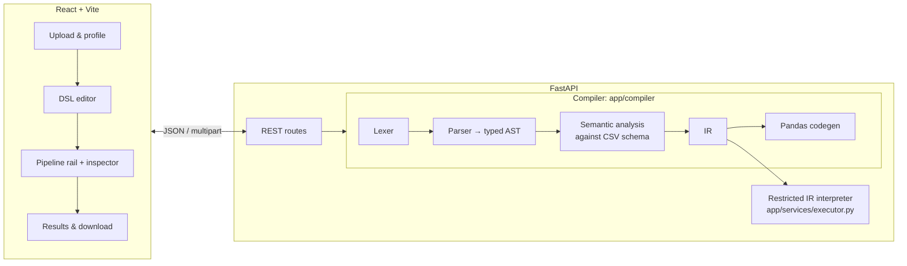

# CleanScript: a data cleaning script compiler

<video src="brag.mp4" controls muted width="100%"></video>

[Watch the demo video](brag.mp4)

CleanScript is a small domain-specific language for cleaning CSV datasets, plus a real compiler for it and a web app to demonstrate it.
You upload a CSV and write a program like the one below. The program goes through a lexer, a recursive-descent parser, a dataset-aware semantic analyzer, IR generation and Pandas code generation. A restricted interpreter then runs the validated IR on a copy of your data, and you download the cleaned CSV.

```text
LOAD "students.csv";
FILL_NULLS AGE USING MEDIAN;
FILL_NULLS MARKS USING MEAN;
REMOVE_DUPLICATES;
FILTER AGE >= 18;
NORMALIZE MARKS;
SORT MARKS DESC;
SAVE "cleaned_students.csv";
```

The compiler is the core deliverable. The UI shows the real output of every stage: tokens, AST, semantic checks with the schema after each statement, IR, generated code and the execution log.

## Architecture



- **The compiler is independent of the web layer.** `app.compiler.compile_source(source, schema, filename)` works from Python, from tests, and from the CLI.
- **Generated code is for inspection only.** The app never runs it, and never runs user text with `eval` or `exec`. The executor maps each IR op to one allow-listed handler. Tests run the generated code in a temp directory and check its output matches the interpreter's.

More detail: [docs/ARCHITECTURE.md](docs/ARCHITECTURE.md) · Language: [docs/DSL_SPEC.md](docs/DSL_SPEC.md) · API: [docs/API.md](docs/API.md) · Report material: [docs/PROJECT_REPORT.md](docs/PROJECT_REPORT.md) · Demo walkthrough: [docs/DEMO_SCRIPT.md](docs/DEMO_SCRIPT.md)

## Folder structure

```text
backend/
  app/
    compiler/   tokens, lexer, ast_nodes, parser, semantic, ir, codegen, errors, pipeline
    services/   dataset_profiler (CSV parsing + profile), executor (IR interpreter), session_store
    api/        routes.py: all REST endpoints
    models/     schemas.py: Pydantic request/response models
    main.py     FastAPI app, CORS, request IDs, JSON error handlers
    config.py   limits (env-overridable)
    cli.py      command-line compiler driver
  scripts/record_demo_fixture.py   records the frontend demo fixture from a real run
  tests/        pytest: lexer, parser, semantic, IR/codegen, executor, profiler, API/end-to-end
frontend/
  src/
    services/   api.js (only network module), highlight.js (editor colouring)
    state/      useWorkspace.js (all workspace state + actions)
    components/ Header, FileUploader, DatasetStats, DataTable, DSLEditor, PipelineVisualizer,
                CompilerInspector, DiagnosticsPanel, ResultsPanel, CopyButton
    pages/      Dashboard, Workspace, Documentation
    demo/       fixture.json (recorded backend responses, demo mode only)
    tests/      vitest + Testing Library
examples/       students.csv, students.clean (canonical), students_extended.* (all commands)
docs/           DSL spec, architecture, API, project report, demo script
```

## Setup

Requires Python 3.11+ (developed on 3.14) and Node 20+ (developed on 25).

### Backend

```powershell
cd backend
python -m venv .venv
.venv\Scripts\Activate.ps1          # macOS/Linux: source .venv/bin/activate
pip install -r requirements.txt
uvicorn app.main:app --reload --port 8000
```

### Frontend (second terminal)

```powershell
cd frontend
npm install
npm run dev
```

Open http://localhost:5173 in a normal browser window. Two things to know:

- **Use your own browser.** If you click "Choose a CSV file" in a browser window opened by an automation tool (Playwright, the Claude browser tools), the tool captures the file picker and nothing appears.
- **Port 5173 must be free.** The dev server uses `strictPort`, so if an old dev server is still holding 5173 it exits with an error instead of quietly moving to 5174 while you keep looking at stale code. Stop the old one first. On Windows, closing the `npm` wrapper can leave `node vite.js` running; `Get-NetTCPConnection -LocalPort 5173` shows its PID.

The Vite dev server proxies `/api` to `http://127.0.0.1:8000`; set `VITE_API_TARGET` to change it. For a separately hosted API, build with `VITE_API_BASE=https://host` and add the frontend origin to `CLEANSCRIPT_CORS_ORIGINS`.

### Command line (no server)

```powershell
cd backend
.venv\Scripts\python -m app.cli ..\examples\students.clean ..\examples\students.csv                  # prints generated code
.venv\Scripts\python -m app.cli ..\examples\students.clean ..\examples\students.csv --stage tokens   # tokens | ast | semantic | ir | code
.venv\Scripts\python -m app.cli ..\examples\students.clean ..\examples\students.csv --run out.csv
```

Errors print as `file:line:column: error [CODE] message` and exit with status 1.

## Using the app

1. **Projects → Open the students sample.** This uploads `examples/students.csv` to the live backend and loads `students.clean`. Or choose **New cleaning project** and upload your own CSV.
2. The **Dataset** panel shows rows, columns, missing cells, duplicates, per-column types, missing counts, numeric stats (hover a column header), and detected issues.
3. After an upload, the editor already holds a program built from the detected issues: REMOVE_DUPLICATES if there are duplicates, DROP_COLUMN for all-empty columns, and FILL_NULLS (MEDIAN for numbers, MODE for text) for each column with gaps. That means any CSV compiles and runs immediately. Edit it freely. **Suggest from issues** rebuilds it, and **Insert statement…** offers snippets built from your real column names. **Ctrl+Enter** compiles.
4. **Compile** lights up the pipeline rail. Click any stage to open its tab in the inspector. Diagnostic links jump to the line and column in the editor.
5. **Run** is enabled only when the *current* source compiled successfully. Editing marks the result as out of date.
6. **Results** shows before/after counts, the cleaned and original previews, and a **Download** link to the CSV the executor produced.

**Demo mode** ("Replay the recorded demo") replays responses recorded from a real backend run by `backend/scripts/record_demo_fixture.py`. It works with the backend offline, is clearly labelled, has a read-only editor, and offers no download.

## API overview

| Method | Path | Purpose |
|---|---|---|
| GET | `/api/health` | Service status |
| POST | `/api/sessions/upload` | Multipart `file`; returns `session_id`, sanitized `filename`, profile |
| GET | `/api/sessions/{id}/profile` | Profile and preview again |
| POST | `/api/sessions/{id}/compile` | `{"source": "..."}` → tokens, AST, semantic trace, IR, code, diagnostics |
| POST | `/api/sessions/{id}/execute` | `{"compilation_id": "..."}` → runs the stored IR |
| GET | `/api/sessions/{id}/result` | Latest result (or `?result_id=`) |
| GET | `/api/sessions/{id}/download` | The result CSV (`?result_id=` optional) |
| DELETE | `/api/sessions/{id}` | Delete the session and its files |

Full contract and status-code policy: [docs/API.md](docs/API.md). Interactive docs: http://127.0.0.1:8000/docs.

## Testing

```powershell
cd backend;  .venv\Scripts\python -m pytest        # 194 tests
cd frontend; npm test                               # 15 tests (vitest)
cd frontend; npm run build                          # production build → frontend/dist
```

After changing API output shapes, re-record the demo fixture: `cd backend; .venv\Scripts\python scripts\record_demo_fixture.py`.

## Configuration

Environment variables (defaults in `backend/app/config.py`):

| Variable | Default |
|---|---|
| `CLEANSCRIPT_MAX_UPLOAD_BYTES` | 5 MB |
| `CLEANSCRIPT_MAX_ROWS` / `CLEANSCRIPT_MAX_COLUMNS` | 200 000 / 200 |
| `CLEANSCRIPT_MAX_SOURCE_CHARS` | 20 000 |
| `CLEANSCRIPT_PREVIEW_ROWS` | 50 |
| `CLEANSCRIPT_SESSION_TTL_SECONDS` | 7200 |
| `CLEANSCRIPT_MAX_SESSIONS` | 100 |
| `CLEANSCRIPT_CORS_ORIGINS` | `http://localhost:5173,http://127.0.0.1:5173` |

## Known limitations

- Sessions live in process memory with files in a private temp directory, removed on expiry and on shutdown. This is fine for one local process, but not for multiple workers or restarts.
- CSV only, UTF-8 only, one dataset per session. Dates are not inferred and are treated as text.
- FILTER has a single comparison. There is no AND/OR, arithmetic, or boolean/datetime filtering.
- The lexer and parser report the first error only. The semantic analyzer reports all errors.
- Starlette's multipart parser receives the whole request before the size check. A `Content-Length` guard rejects obviously oversized requests early.
- Previews show the first 50 rows. Downloads contain everything.
