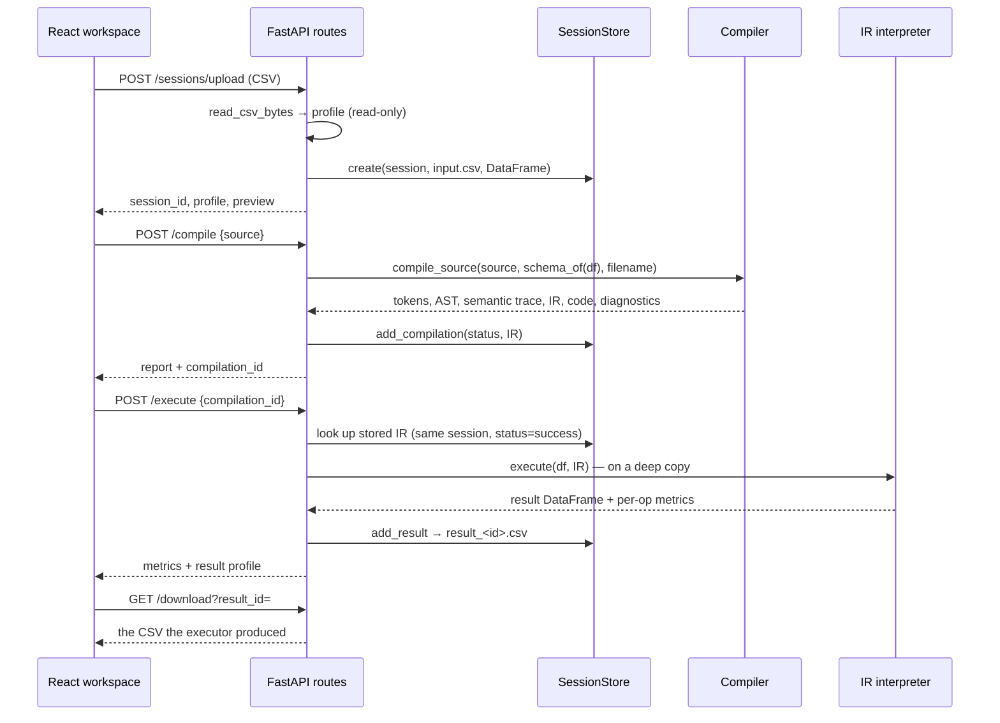

# Architecture

## Compiler stages (`backend/app/compiler/`)

| Stage | Module | Input → output | Errors |
|---|---|---|---|
| Lexical analysis | `lexer.py`, `tokens.py` | text → `list[Token]` (type, lexeme, value, line, column, end_column) | first error, raised as `CompileError` |
| Syntax analysis | `parser.py`, `ast_nodes.py` | tokens → typed `Program` AST (one dataclass per statement, each with a `Span`) | first error, with expected/found text and hints |
| Semantic analysis | `semantic.py` | AST + `list[ColumnInfo]` + uploaded filename → diagnostics + per-statement schema trace | all errors, warnings, info |
| IR generation | `ir.py` | validated AST → `{"version", "input", "output", "instructions": [...]}` | n/a (only runs after semantic success) |
| Code generation | `codegen.py` | IR → deterministic Pandas source (all user text emitted via `repr()`) | n/a |
| Orchestration | `pipeline.py` | runs the stages and records which passed/failed/skipped | |

The semantic analyzer's mutable schema is effectively a symbol table. RENAME rebinds a name, DROP_COLUMN removes it, FILL_NULLS/REMOVE_NULLS clear the may-be-null flag, and NORMALIZE changes the type to float. So `RENAME NAME TO STUDENT; SORT NAME ASC;` fails on line 2, exactly as it would at run time.

## Execution (`backend/app/services/executor.py`)

- `validate_ir()` re-checks the stored IR: known ops only, required argument types, allowed strategy/operator/direction values.
- `HANDLERS` is a fixed dict from op name to function. There is no `eval`, `exec`, `getattr` on user strings, import, or file access.
- Handlers return new DataFrames (or copies) and metrics. The session's original DataFrame is never mutated (asserted in tests), and a failure discards the partial result.
- Each handler mirrors the code that `codegen.py` emits. `tests/test_ir_codegen.py` runs the generated code in a temp directory and requires byte-identical CSV output for several programs, including the full extended example.

## Data handling (`backend/app/services/`)

- `dataset_profiler.read_csv_bytes` decodes UTF-8 (BOM allowed) and rejects empty files, blank or duplicate headers, rows wider than the header, and unparsable CSV. It parses with nullable dtypes, the same call the generated code makes.
- `profile()` reports counts, types, missing values, duplicates, numeric stats and warnings, plus a preview of up to 50 rows. It never mutates data.
- `session_store.SessionStore` uses one private `tempfile.mkdtemp` root and one subdirectory per opaque session id (`secrets.token_urlsafe`). Uploads are stored as `input.csv` and results as `result_<id>.csv`, so user-supplied names never become paths. TTL expiry and LRU eviction delete directories, and the root is removed on shutdown.

## Frontend (`frontend/src/`)

- `services/api.js` is the only module that performs network I/O. Upload uses XHR so the UI can show progress.
- `state/useWorkspace.js` holds all workspace state: session, source, last compile (with the exact source it compiled), execution, busy flags and errors. **Stale protection** compares the current source to the compiled source; Run requires `status === "success"` and no staleness. Demo mode swaps API calls for the recorded fixture.
- Components only render props. `PipelineVisualizer` derives stage status from the real `stages` map and execution result. `CompilerInspector` renders tokens, AST tree, semantic trace, IR, code and execution log.
- `services/highlight.js` colours the editor for display only. It doesn't validate anything; the backend lexer does that.
- Routing is hash-based (`#/dashboard`, `#/workspace`, `#/docs`), with no router dependency.
- `localStorage` holds only recent session ids and filenames, never dataset contents.

## Security summary

| Threat | Mitigation |
|---|---|
| Code injection via DSL | Grammar-only input; executor is an allow-list; generated code is never run by the app; codegen escapes via `repr()` |
| Tampered instructions | Execute takes only a `compilation_id`; IR comes from server storage and is re-validated |
| Path traversal via LOAD/SAVE/filename | LOAD must equal the sanitized upload name; SAVE regex-restricted basename; storage paths are server-chosen |
| Cross-session access | Compilations/results looked up inside the session; opaque random ids |
| Resource abuse | Upload size, rows, columns, source length, session count/TTL limits; `Content-Length` guard |
| Information leakage | Uniform JSON errors; generic 500 handler; no paths or tracebacks in responses |
| CORS | Explicit origin allow-list (Vite dev origins by default) |
